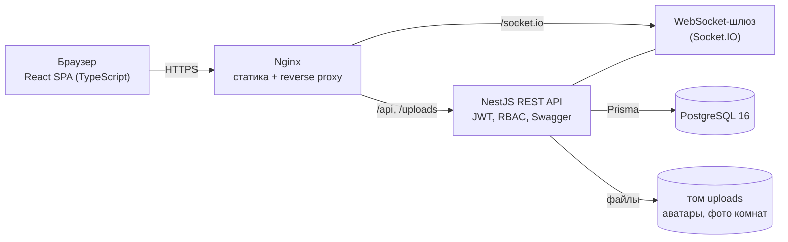
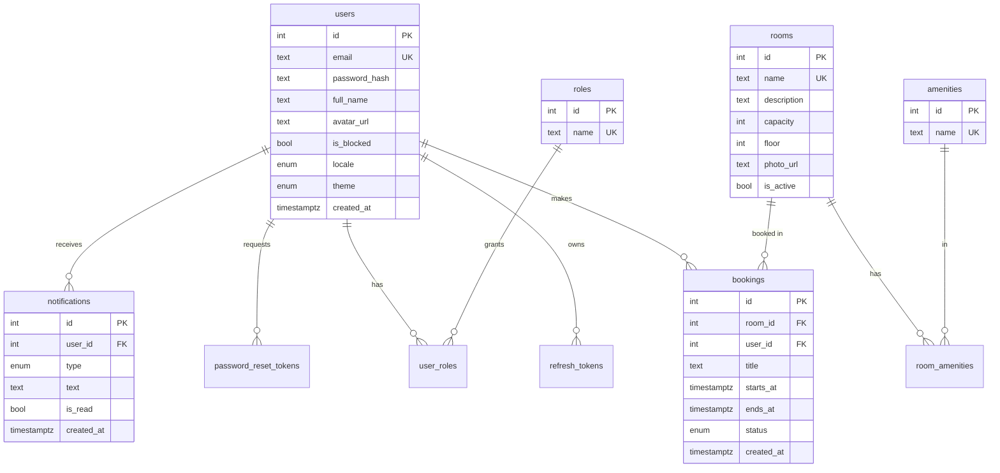

# Архитектура

## Компоненты



## Слои бэкенда

```
HTTP-запрос -> Guards (JwtAuthGuard, RolesGuard) -> ValidationPipe (DTO)
            -> Controller (приём/ответ, без бизнес-логики)
            -> Service (бизнес-правила: пересечения броней, права на ресурс, уведомления)
            -> Prisma (репозиторный слой, параметризованные запросы)
            -> PostgreSQL (ограничения: UNIQUE, FK, CHECK, EXCLUDE)
Ошибки: AllExceptionsFilter -> { error: { code, message, details } }
Успех:  ResponseInterceptor -> { data, meta? }
```

## ER-диаграмма



10 таблиц (по ТЗ нужно не менее 6): `users`, `roles`, `user_roles` (M:N), `rooms`, `amenities`, `room_amenities` (M:N),
`bookings` (1:N к комнатам и пользователям), `refresh_tokens`, `password_reset_tokens`, `notifications`.

## Защита от пересечений бронирований (ключевая «изюминка»)

Два уровня защиты:

1. **Сервис** (`BookingsService.assertNoOverlap`) проверяет пересечение запросом и возвращает понятную ошибку `409 BOOKING_OVERLAP`.
2. **База данных** — ограничение `EXCLUDE USING gist (room_id WITH =, tstzrange(starts_at, ends_at) WITH &&) WHERE (status = 'ACTIVE')`
   (миграция `20261021000100_booking_no_overlap`). Если два запроса придут одновременно и оба пройдут проверку сервиса,
   второй всё равно будет отклонён самой БД (код PostgreSQL `23P01`), сервис превратит его в тот же `409`.

Интервалы полуоткрытые `[начало, конец)`: бронь 10:00–11:00 и 11:00–12:00 не пересекаются.

## Безопасность

| Угроза | Мера |
|---|---|
| Хранение паролей | bcrypt (10 раундов), хэш никогда не возвращается в API |
| Кража сессии | access JWT 15 минут; refresh-токен случайный, в БД только SHA-256 хэш, ротация при каждом обновлении, отзыв при выходе, блокировке и смене пароля |
| Повышение привилегий | `RolesGuard` на сервере; роли и блокировка перечитываются из БД при каждом запросе |
| Доступ к чужим данным (IDOR) | `BookingsService.findAccessible`: чужая бронь — 403; `/bookings/my` фильтрует по `userId` из токена |
| SQL-инъекции | только Prisma (параметризованные запросы), сортировка по белому списку полей |
| XSS | React экранирует вывод, `dangerouslySetInnerHTML` не используется |
| CORS | разрешён только `FRONTEND_URL` |
| Загрузка файлов | только JPG/PNG, лимит размера (2 МБ аватар, 5 МБ фото), имя файла генерируется (UUID), расширение из MIME |
| Перебор email | одинаковый ответ на неверный email и пароль; `forgot-password` отвечает одинаково для любого email |
| Секреты | только через переменные окружения, `.env` в `.gitignore`, шаблон в `.env.example` |
